# Win-XinAi-De-Tools

**English** | [简体中文](README.zh-CN.md)

A native Windows utility for firewall rules, network settings, SMB, WSL, Hyper-V, and temporary HTTP serving. Built with WinUI 3 and Skia dashboard graphics, with English/Chinese, light/dark themes, responsive layouts, and Back navigation.

## Download

**v1.12.1** · [GitHub Releases](https://github.com/logdns/Win-XinAi-De-Tools/releases/latest) · [Actions](https://github.com/logdns/Win-XinAi-De-Tools/actions/workflows/build.yml)

Requires Windows 10 1809 or later. Extract the portable ZIP or run the installer, then launch the app as administrator. Packages include the .NET and Windows App SDK runtimes.

The installer offers **desktop** and **Start Menu** shortcuts as independent options, both selected by default. They work even if you uncheck launching the app after installation. Search for `Win-XinAi-De-Tools` in Start or open its Start Menu folder. ZIP packages do not create shortcuts. See [installation and shortcuts](docs/INSTALLATION.md).

| Architecture | Portable | Installer |
|---|---|---|
| x64 | [ZIP](https://github.com/logdns/Win-XinAi-De-Tools/releases/download/v1.12.1/Win-XinAi-De-Tools-win-x64.zip) | [EXE](https://github.com/logdns/Win-XinAi-De-Tools/releases/download/v1.12.1/Win-XinAi-De-Tools-Setup-x64.exe) |
| x86 | [ZIP](https://github.com/logdns/Win-XinAi-De-Tools/releases/download/v1.12.1/Win-XinAi-De-Tools-win-x86.zip) | [EXE](https://github.com/logdns/Win-XinAi-De-Tools/releases/download/v1.12.1/Win-XinAi-De-Tools-Setup-x86.exe) |
| ARM64 | [ZIP](https://github.com/logdns/Win-XinAi-De-Tools/releases/download/v1.12.1/Win-XinAi-De-Tools-win-arm64.zip) | [EXE](https://github.com/logdns/Win-XinAi-De-Tools/releases/download/v1.12.1/Win-XinAi-De-Tools-Setup-arm64.exe) |

[SHA256SUMS.txt](https://github.com/logdns/Win-XinAi-De-Tools/releases/download/v1.12.1/SHA256SUMS.txt) provides download checksums.

## Parallel Editions

| Edition | Interface / architectures | x64 portable / installer | ARM64 portable / installer |
|---|---|---|---|
| Original WinUI | WinUI 3 + Skia; x86/x64/ARM64 | See above | See above |
| **Win-XinAi-De-Tools-MyGo** | **Built with MyGo**, native Go GPU UI; x64/ARM64 | [ZIP](https://github.com/logdns/Win-XinAi-De-Tools/releases/download/v1.12.1/Win-XinAi-De-Tools-MyGo-win-x64.zip) / [EXE](https://github.com/logdns/Win-XinAi-De-Tools/releases/download/v1.12.1/Win-XinAi-De-Tools-MyGo-Setup-x64.exe) | [ZIP](https://github.com/logdns/Win-XinAi-De-Tools/releases/download/v1.12.1/Win-XinAi-De-Tools-MyGo-win-arm64.zip) / [EXE](https://github.com/logdns/Win-XinAi-De-Tools/releases/download/v1.12.1/Win-XinAi-De-Tools-MyGo-Setup-arm64.exe) |

Install identities, shortcuts and UI preferences are independent. Inspired by [Pulse](https://pulse.egoist.dev/), MyGo uses native Go controls, not a WebView. It includes a self-contained .NET system engine: no tiny standalone-binary claim. Dedicated feature pages automatically load real state and show searchable rule/connection lists, populated adapter settings, Hyper-V/SMB/WSL controls and individual HTTP URL actions. Advanced WSL tools have grouped forms; application login startup is not offered. **Both editions manage the same Windows configuration; avoid conflicting simultaneous changes.** See the [MyGo guide and differences](docs/MYGO.md).

## Features

- **Local network reset**: DNS cache, selected-adapter DHCP/automatic DNS, or system Winsock/TCP/IP. Snapshot first, Cancel by default, no automatic reboot; see [reset and recovery](docs/NETWORK-RESET.md).
- **Temporary HTTP**: configurable port (8980 by default), folder selection/opening, Start/Stop/Restart, individual URL copy/open actions, and local HTTP detection with port/process details. Supports external access; see the [HTTP guide](docs/TEMPORARY-HTTP.md).
- **Firewall and networking**: manage rules, query ports, configure adapters/DNS/routes, inspect connections and processes, import/export rules, and review operation logs.
- **SMB**: manage SMB Direct, SMB 1.0/CIFS, and folder sharing.
- **WSL**: install and manage distributions, open terminals, import/export/migrate, and manage storage, proxies, port forwarding, and USB devices.
- **Hyper-V**: feature-only or complete platform/boot disable, virtual adapter controls, internal/private/external switches and host NIC sharing. See the [Hyper-V/network guide](docs/HYPER-V.md).
- **Desktop**: saved appearance/language, history-based Back, notification-area support, WinUI logon startup, and `/silent`.

System configuration changes require administrator privileges. Enable the legacy SMB 1.0 protocol only when needed. One-command WSL installation requires Windows 10 2004 or later.

## Interface

Actual Windows x64 screenshots from the [v1.12.0 release UI verification](https://github.com/logdns/Win-XinAi-De-Tools/actions/runs/39005734844). System status and available controls depend on the host configuration. MyGo now shows dedicated feature pages, not an operation-selector/JSON console. The adapter settings screenshot is an unsubmitted Static draft populated from a DHCP adapter; no network configuration was changed.

### Dashboard

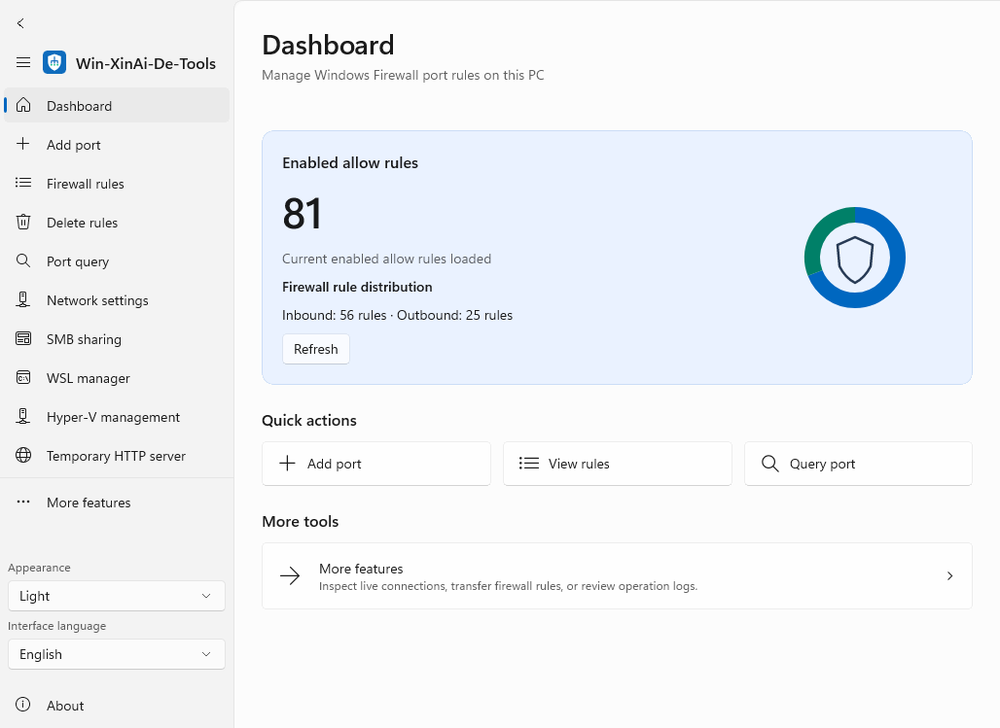

### Hyper-V features and boot configuration

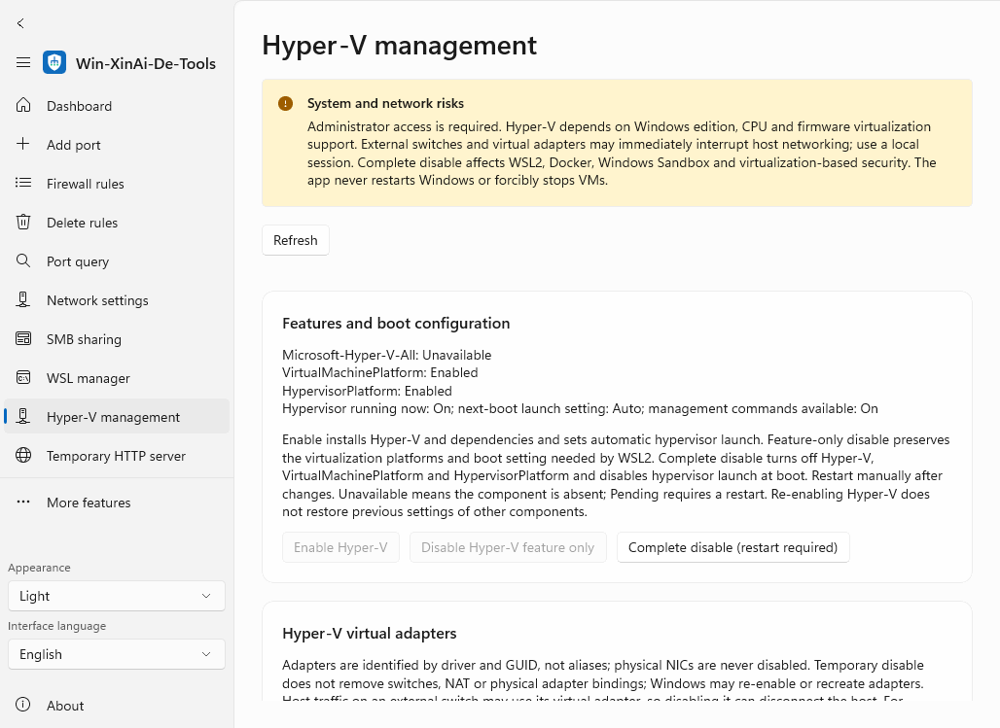

### Hyper-V virtual adapters and switches

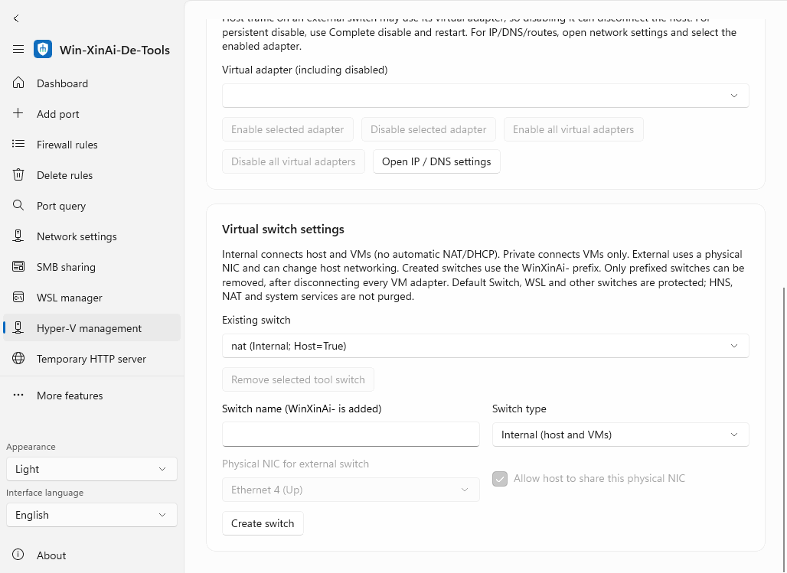

### Local HTTP discovery

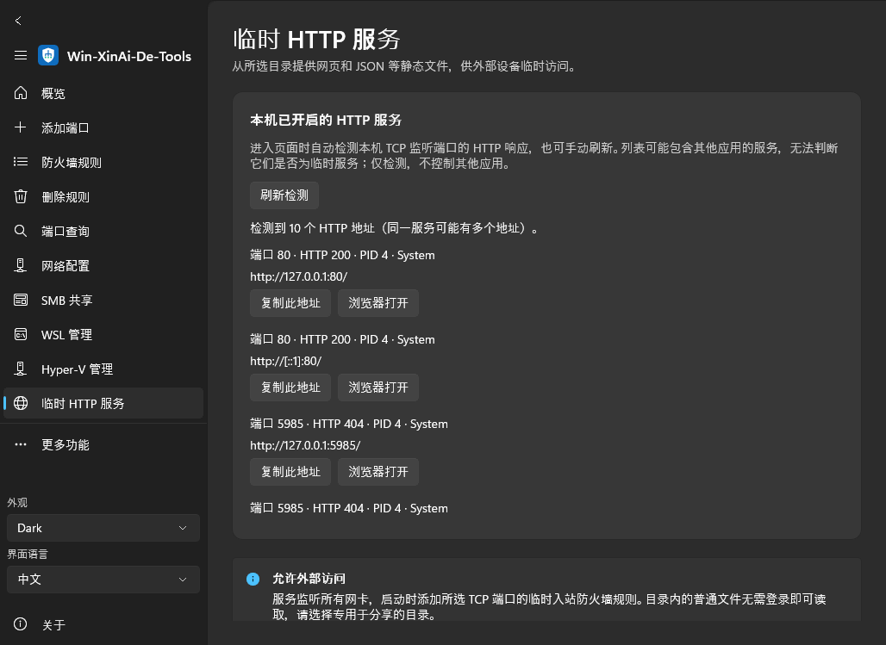

### Local network reset (WinUI)

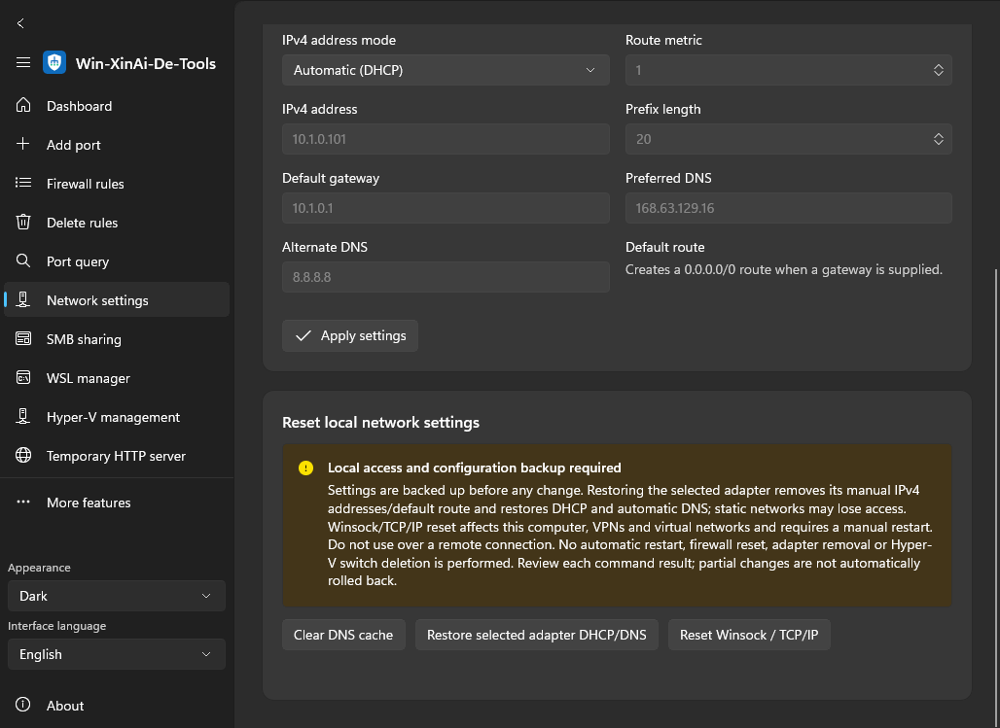

### Built with MyGo: native overview

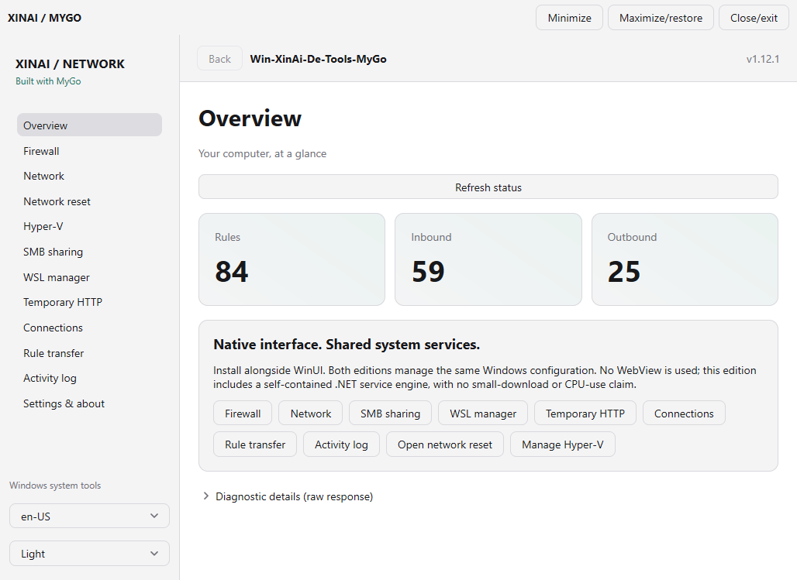

### Built with MyGo: rules and direct actions

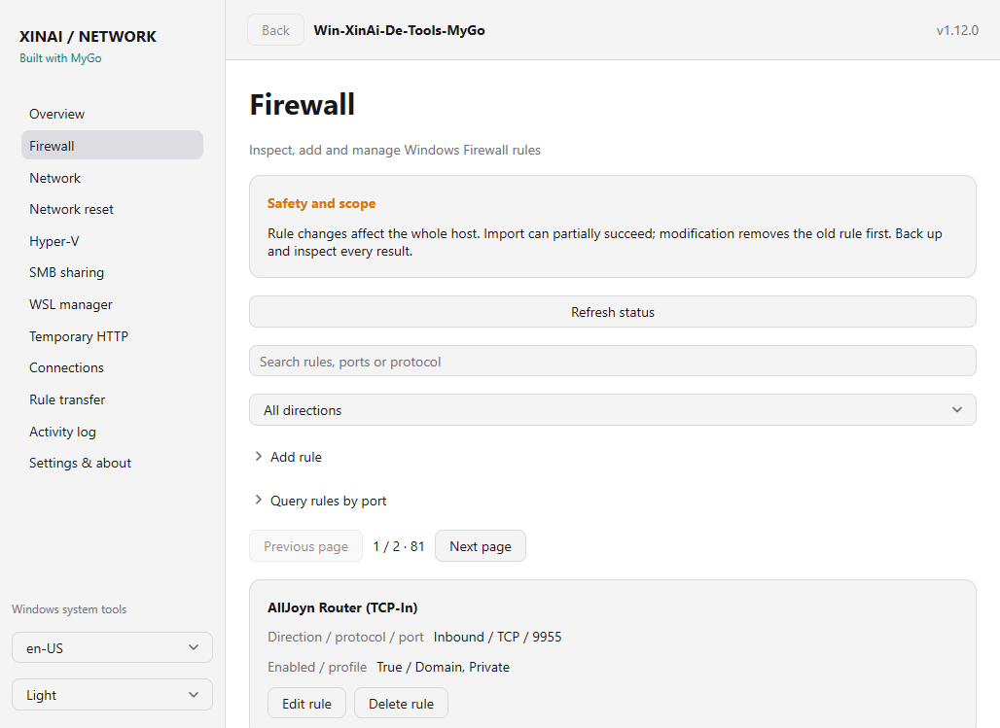

### Built with MyGo: populated IP/DNS settings

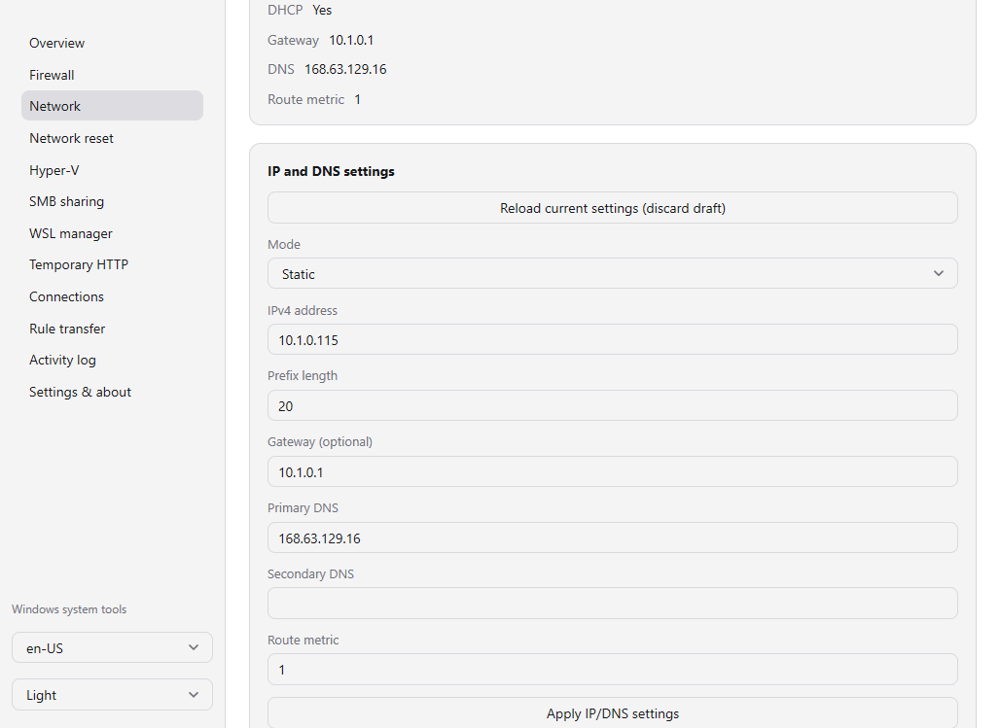

### Built with MyGo: Hyper-V platform and networking

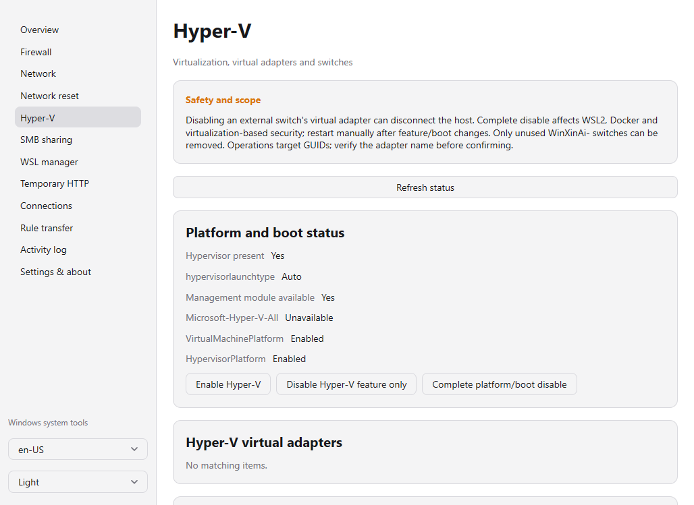

Virtual switch settings and connection monitor

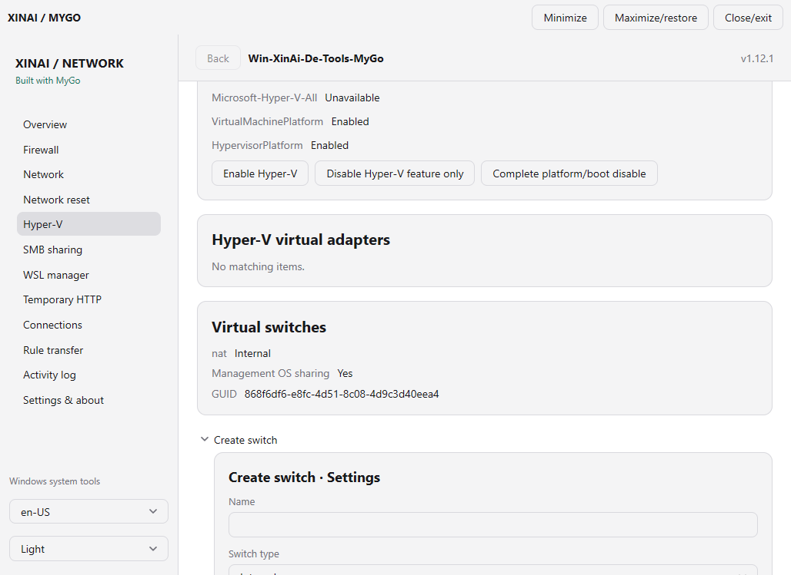

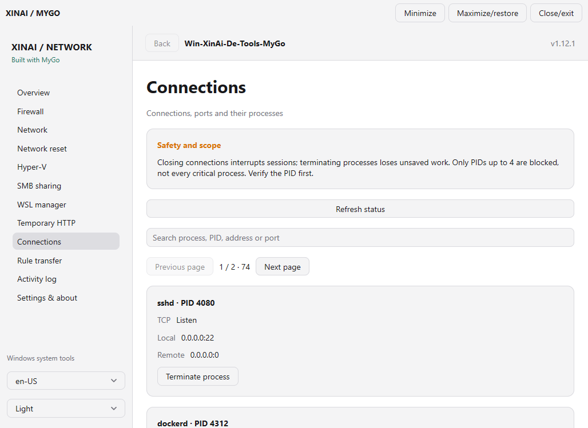

### Built with MyGo: network reset

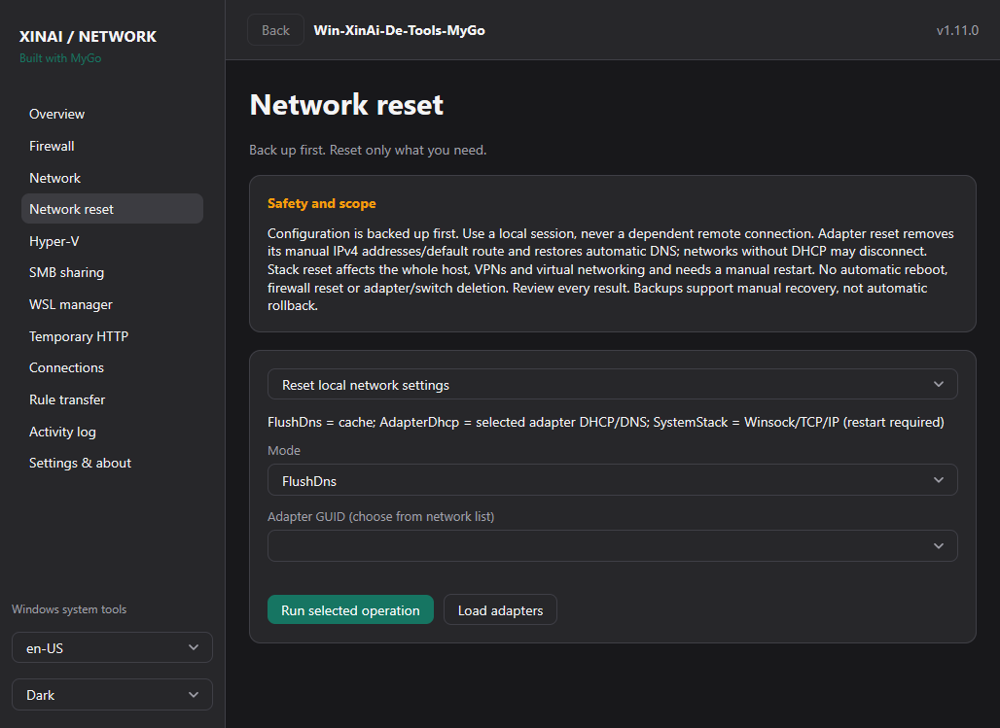

## Documentation and development

- [Local network reset, snapshots and recovery](docs/NETWORK-RESET.md)
- [MyGo edition, differences and build](docs/MYGO.md)
- [Hyper-V settings, network risks and recovery](docs/HYPER-V.md)
- [HTTP usage and internet access](docs/TEMPORARY-HTTP.md)
- [UI behavior and validation](docs/UI-AND-VALIDATION.md)
- [Build, test, and contribute](CONTRIBUTING.md)
- [Current audit and verification](docs/AUDIT.md)
- [Recent changes](CHANGELOG.md) · [Previous releases](https://github.com/logdns/Win-XinAi-De-Tools/releases)

Released under the [MIT License](LICENSE). See [THIRD-PARTY-NOTICES.md](THIRD-PARTY-NOTICES.md) for third-party licenses.
