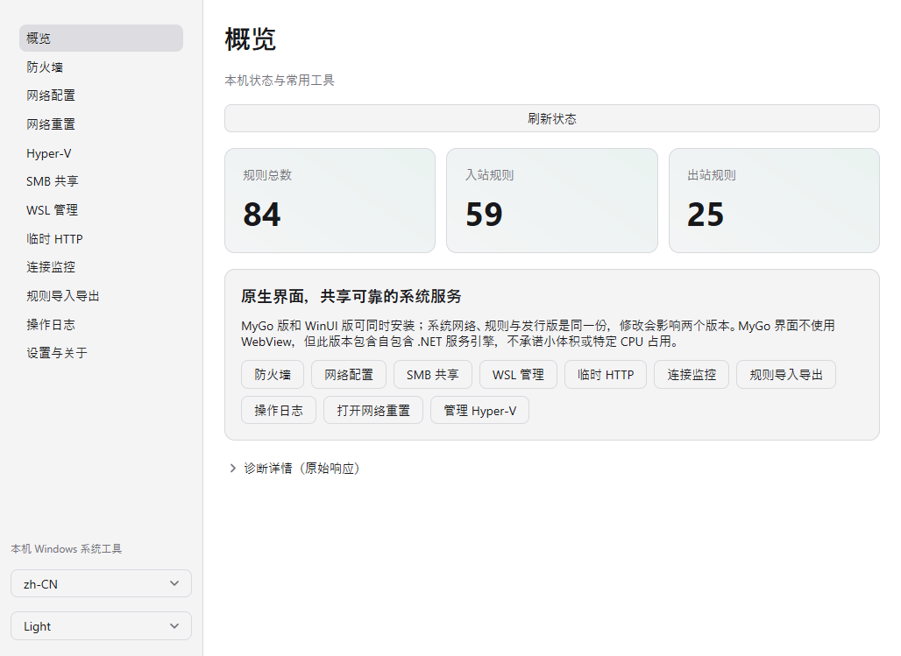
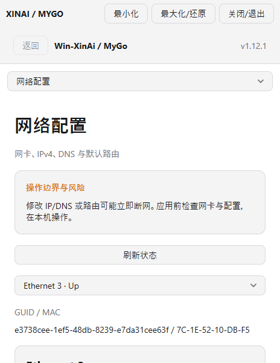
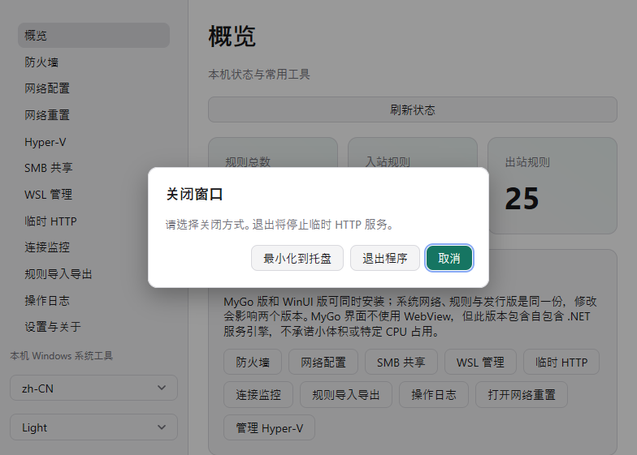
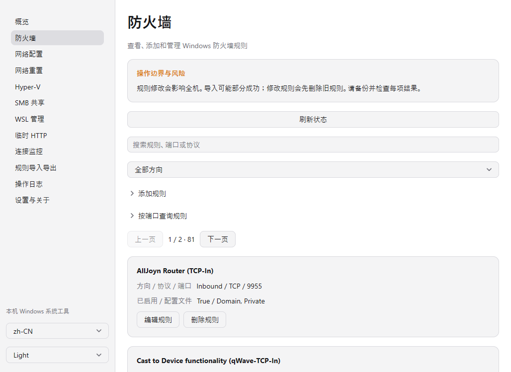
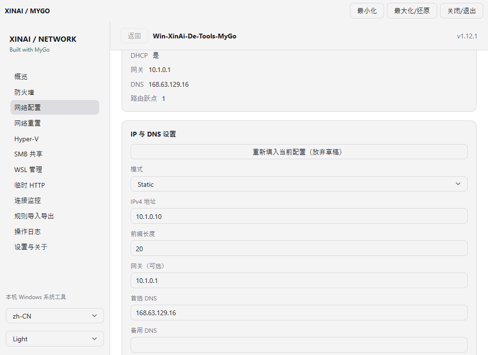
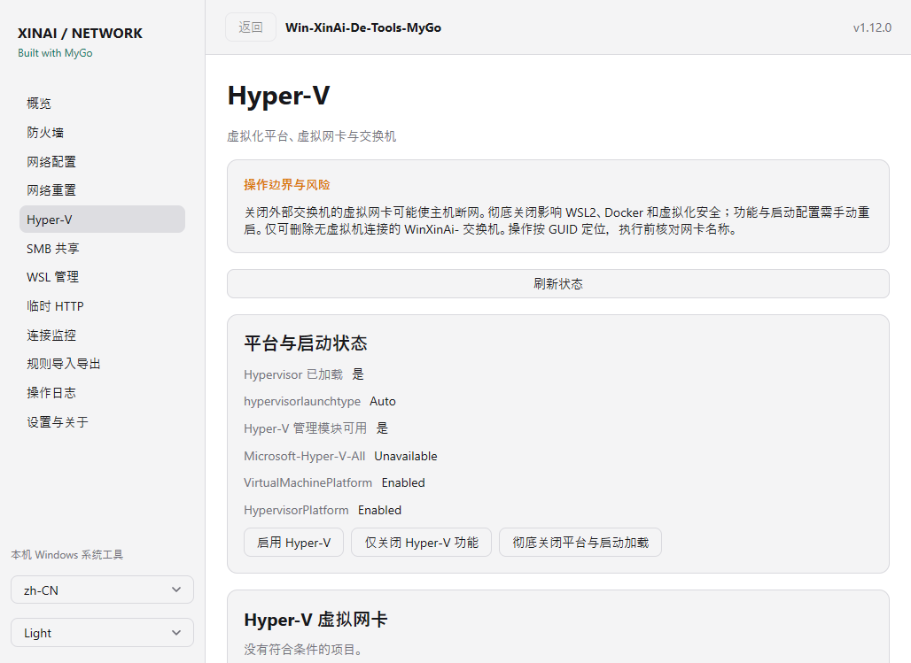
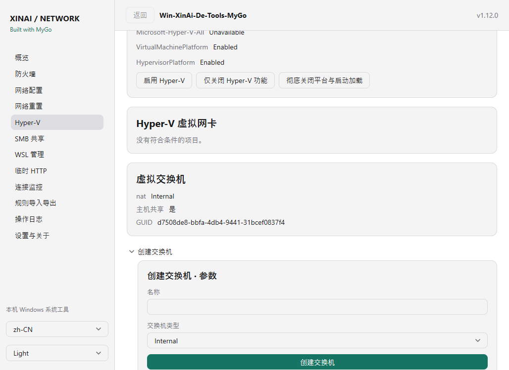
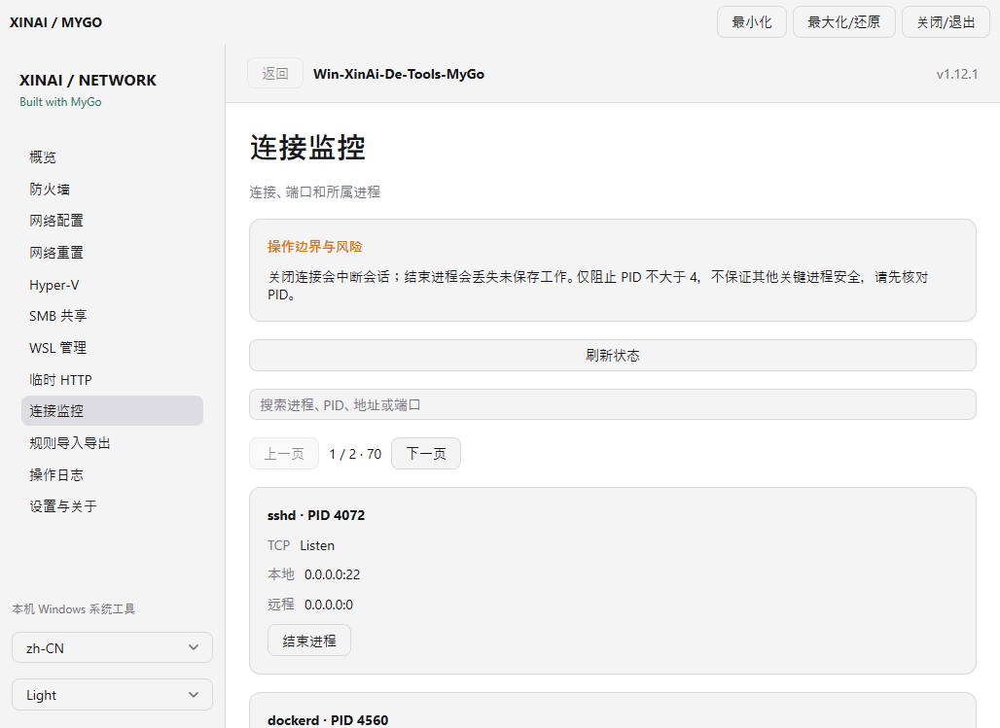
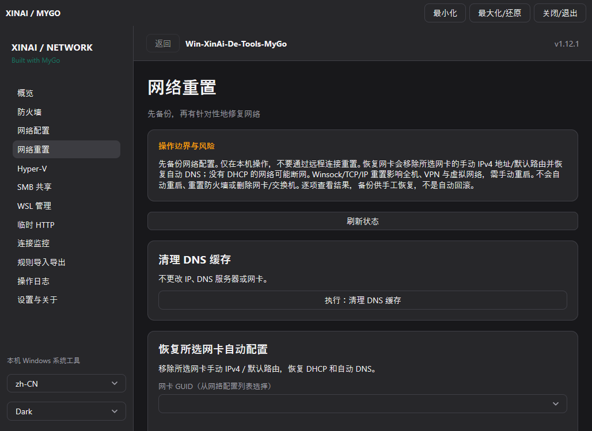

# Win-XinAi-De-Tools

[English](README.md) | **简体中文**

原生 Windows 网络工具，集中管理防火墙、网络配置、SMB、WSL、Hyper-V 和临时 HTTP 服务。支持中英文、深浅色主题、自适应布局与返回导航；使用 WinUI 3 原生控件和 Skia 概览图形。

## 下载

**v1.12.2** · [GitHub Releases](https://github.com/logdns/Win-XinAi-De-Tools/releases/latest) · [Actions](https://github.com/logdns/Win-XinAi-De-Tools/actions/workflows/build.yml)

需要 Windows 10 1809 或更高版本。解压便携 ZIP 或运行安装程序，以管理员身份启动应用。软件包自包含，无需另装 .NET 或 Windows App SDK。

安装时可独立选择**创建桌面快捷方式**和**创建开始菜单快捷方式**，默认均勾选；即使取消安装完成后立即运行，也能通过快捷方式找到软件。在开始菜单搜索 `Win-XinAi-De-Tools` 或打开同名文件夹即可。ZIP 便携版不会自动创建快捷方式，详见[安装与快捷方式说明](docs/INSTALLATION.md)。

| 架构 | 便携版 | 安装版 |
|---|---|---|
| x64 | [ZIP](https://github.com/logdns/Win-XinAi-De-Tools/releases/download/v1.12.2/Win-XinAi-De-Tools-win-x64.zip) | [EXE](https://github.com/logdns/Win-XinAi-De-Tools/releases/download/v1.12.2/Win-XinAi-De-Tools-Setup-x64.exe) |
| x86 | [ZIP](https://github.com/logdns/Win-XinAi-De-Tools/releases/download/v1.12.2/Win-XinAi-De-Tools-win-x86.zip) | [EXE](https://github.com/logdns/Win-XinAi-De-Tools/releases/download/v1.12.2/Win-XinAi-De-Tools-Setup-x86.exe) |
| ARM64 | [ZIP](https://github.com/logdns/Win-XinAi-De-Tools/releases/download/v1.12.2/Win-XinAi-De-Tools-win-arm64.zip) | [EXE](https://github.com/logdns/Win-XinAi-De-Tools/releases/download/v1.12.2/Win-XinAi-De-Tools-Setup-arm64.exe) |

[SHA256SUMS.txt](https://github.com/logdns/Win-XinAi-De-Tools/releases/download/v1.12.2/SHA256SUMS.txt) 用于校验下载文件。

## 两个版本并行发布

| 版本 | 界面与架构 | x64 便携 / 安装 | ARM64 便携 / 安装 |
|---|---|---|---|
| 原版 WinUI | WinUI 3 + Skia；x86/x64/ARM64 | 见上表 | 见上表 |
| **Win-XinAi-De-Tools-MyGo** | **Built with MyGo** 原生 Go GPU 界面；x64/ARM64 | [ZIP](https://github.com/logdns/Win-XinAi-De-Tools/releases/download/v1.12.2/Win-XinAi-De-Tools-MyGo-win-x64.zip) / [EXE](https://github.com/logdns/Win-XinAi-De-Tools/releases/download/v1.12.2/Win-XinAi-De-Tools-MyGo-Setup-x64.exe) | [ZIP](https://github.com/logdns/Win-XinAi-De-Tools/releases/download/v1.12.2/Win-XinAi-De-Tools-MyGo-win-arm64.zip) / [EXE](https://github.com/logdns/Win-XinAi-De-Tools/releases/download/v1.12.2/Win-XinAi-De-Tools-MyGo-Setup-arm64.exe) |

两版独立安装、快捷方式与界面设置，可同时保留。MyGo 借鉴 [Pulse](https://pulse.egoist.dev/) 的分区与状态卡片，不使用 WebView；包含自包含 .NET 系统服务引擎，不是单文件小体积版本。各功能页进入自动加载真实状态，直接展示规则/连接列表、网卡设置、Hyper-V/SMB/WSL 控件和 HTTP 地址按钮；WSL 高级功能使用分组表单；不提供应用登录自启开关。**两版共用同一台电脑的系统配置，勿并发执行冲突操作。** 详见 [MyGo 版本、差异与构建](docs/MYGO.md)。

## v1.12.2 修复

- 去掉 MyGo 左侧重复品牌、内容区标题/返回栏与右上角文字按钮，只保留标准 Windows 标题栏。
- 点击系统 X 才弹出“最小化到托盘 / 退出程序 / 取消”，默认取消；操作进行中仍禁止退出，明确退出后清理共享引擎和 HTTP 服务。
- 保留窗口工作区适配、安装后启动与快捷方式修复、中文输出修复，两版继续并行发布。

## 功能

- **本地网络重置**：清理 DNS 缓存、所选网卡 DHCP/自动 DNS、整机 Winsock/TCP/IP；先备份、默认取消、不自动重启，见[重置与恢复](docs/NETWORK-RESET.md)。
- **临时 HTTP**：默认端口 8980，可自定义端口、选择/打开目录、启动/停止/重启；逐条复制和打开地址，自动检测本机 HTTP 服务并显示端口和进程。支持外部访问，详见 [HTTP 使用指南](docs/TEMPORARY-HTTP.md)。
- **防火墙与网络**：管理规则，查询端口，配置网卡、DNS 和路由，监控连接和进程，导入/导出规则与查看操作日志。
- **SMB**：管理 SMB Direct、SMB 1.0/CIFS 和共享目录。
- **WSL**：安装与管理发行版，打开终端，导入/导出和迁移，管理存储、代理、端口转发与 USB 设备。
- **Hyper-V**：启用、仅关闭功能或彻底关闭虚拟化平台与启动加载；虚拟网卡单独/全部启停，创建内部/专用/外部交换机并设置主机共享。详见 [Hyper-V 与网络指南](docs/HYPER-V.md)。
- **桌面体验**：保存主题和语言，按访问历史返回，支持托盘、原版登录自启与 `/silent`。

修改系统配置需要管理员权限。SMB 1.0 属于旧协议，请按需启用。一键安装 WSL 需要 Windows 10 2004 或更新版本。

## 界面

以下为 [v1.12.2 正式发布构建界面验证](https://github.com/logdns/Win-XinAi-De-Tools/actions/workflows/build.yml)生成的 Windows x64 实际软件截图。系统状态与可用操作取决于主机配置。MyGo 现为专用功能界面，不再是操作下拉框与 JSON 控制台。网卡设置截图是从实际 DHCP 网卡回填后、尚未提交的 Static 草稿，未修改主机网络。

### 概览

### Hyper-V 功能与启动配置

### Hyper-V 虚拟网卡与交换机

### 本机 HTTP 服务检测

### 本地网络重置（原版 WinUI）

### Built with MyGo：原生概览

### Built with MyGo：小屏适配与窗口控制

首次窗口按屏幕工作区计算尺寸；窗口控制只使用标准 Windows 标题栏，点击系统 X 才显示“最小化到托盘 / 退出程序 / 取消”，不再常驻一排按钮。下图为实际原生内容截图，不包含系统标题栏，不是整张桌面截图；Alt+Left 仍可按历史返回。

### Built with MyGo：规则列表与直接操作

### Built with MyGo：回填 IP/DNS 设置

### Built with MyGo：Hyper-V 平台与网络

展开虚拟交换机设置与连接监控

### Built with MyGo：网络重置

## 文档与开发

- [本地网络重置、备份与恢复](docs/NETWORK-RESET.md)
- [MyGo 版本差异与构建](docs/MYGO.md)
- [Hyper-V 设置、网络风险与恢复](docs/HYPER-V.md)
- [HTTP 使用与外网访问](docs/TEMPORARY-HTTP.md)
- [界面行为与验证](docs/UI-AND-VALIDATION.md)
- [构建、测试与贡献](CONTRIBUTING.md)
- [当前审计与验证记录](docs/AUDIT.md)
- [近期更新](CHANGELOG.md) · [历史版本](https://github.com/logdns/Win-XinAi-De-Tools/releases)

使用 [MIT License](LICENSE) 发布；第三方许可见 [THIRD-PARTY-NOTICES.md](THIRD-PARTY-NOTICES.md)。
